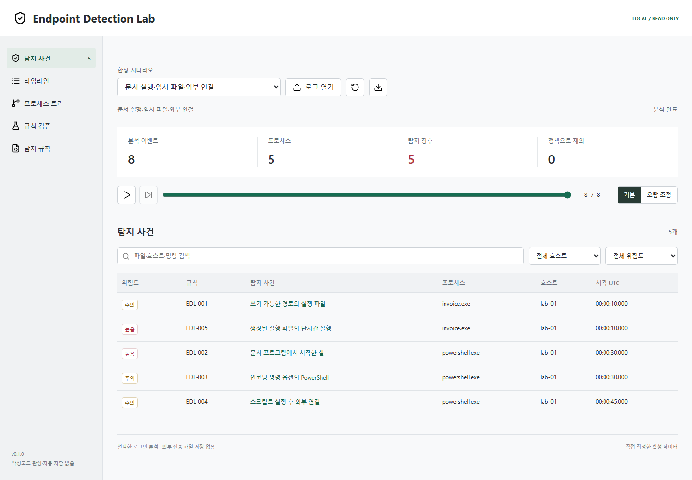

# Endpoint Detection Lab

최근 검사: [대표 10개·전체 회귀·웹 테스트 공개 기록](docs/testing/README.md). 원본 개인정보와 비밀값은 포함하지 않습니다.

Sysmon 내보내기 로그를 분석하고, **탐지 근거와 오탐 조정 결과를 재현하는 로컬 보안 포트폴리오**입니다.
실시간 수집 에이전트·상용 EDR·백신·자동 차단 제품은 아닙니다.



## 바로 실행

Python 3.11 이상이면 외부 API 키·런타임 패키지 없이 실행됩니다.

```powershell
python run.py serve
```

`http://127.0.0.1:8894/`에서 열립니다. Windows에서는 `Start-Lab.cmd`도 사용할 수 있습니다.
포트를 사용 중이면 `python run.py serve --port 8895`로 변경합니다.
첫 화면의 모든 이벤트는 직접 작성한 합성 데이터이며 실제 명령 실행·네트워크 연결은 발생하지 않습니다.

## 무엇을 보여주는가

- Sysmon XML / 정규화 JSON 입력, UTC 정렬, 정확히 같은 이벤트 중복 제외.
- 호스트 + ProcessGuid 연결. PID 재사용·호스트 간 충돌 방지, 부모 누락·순환·시간 모순 표시.
- 탐지 규칙 5개, 규칙별 근거·관련 이벤트·정상 작업 가능성·탐지 한계.
- 타임라인, 프로세스 트리, 검색·호스트·위험도 필터, 50개 단위 페이지 이동.
- 이벤트 접두 구간 재생, 기본 / 오탐 조정 정책, 제외된 탐지 기록 보존.
- 합성 시나리오 18개와 TP/FP/FN 비교, 명시적 JSON 보고서 저장.

## 직접 작성한 규칙

- `EDL-001`: 임시·공용 사용자 경로에서 시작된 실행 파일(ProcessCreate).
- `EDL-002`: 문서 프로그램에서 시작한 셸·스크립트 인터프리터.
- `EDL-003`: PowerShell의 `-enc` / `-EncodedCommand` 옵션.
- `EDL-004`: 인터프리터 생성 후 120초 이내의 외부 아웃바운드 연결.
- `EDL-005`: 쓰기 가능한 경로에 생성된 실행 파일이 300초 이내 같은 호스트에서 실행됨.

서드파티 탐지 규칙을 복사하지 않았으며 Sigma 규칙 호환 엔진이라고 주장하지 않습니다.
실행 경로·옵션·연결은 위험 **징후**이지 악성 행위의 증명이 아닙니다.

## CLI

```powershell
python run.py analyze samples/incident-chain.xml --output report.json
python run.py analyze samples/incident-chain.json --replay-count 4
python run.py analyze samples/incident-chain.json --tuned
python run.py analyze my-log.xml --policy samples/tuned-policy.json
python run.py validate --output validation-report.json
```

종료 코드: `0` 탐지 없음 또는 합성 검증 기대 결과 일치, `1` 탐지 있음 또는 합성 검증 실패,
`2` 입력·파싱·출력 오류, `130` 중단. `0`은 안전 판정이 아닙니다.
`--output`은 새 파일만 생성하며 기존 파일·입력·링크를 덮어쓰지 않습니다.
설치형 CLI: `python -m pip install .` 후 `endpoint-lab`.

## 검증 결과 해석

18개 합성 시나리오에서 기본 정책은 TP 16 / FP 2 / FN 0,
정확 일치 예외를 적용한 조정 정책은 TP 16 / FP 0 / FN 0이 기대 결과입니다.
이는 **작은 자체 합성 표본에 대한 기능 회귀 검사**이며 현장 탐지율이나 일반적인 오탐 감소 성능이 아닙니다.
정답은 별도 시나리오 manifest에만 있고 실제 분석 엔진의 입력 스키마에는 정답 라벨이 없습니다.

```powershell
python -m pip install .
python -m unittest discover -v
python tools/check_publication.py
npm install --no-save --package-lock=false playwright@1.64.0
npx playwright install chromium
node tests/browser/smoke.mjs
```

## 보안 경계

8 MiB / 이벤트 10,000개 / 필드 4,096자 / XML 깊이 16 / XML 노드 400,000개를 제한합니다.
탐지·제외 상세 목록은 각각 500개까지이며 높은 위험·먼저 발생한 항목을 우선 보존합니다. 총계는 전체 입력 기준입니다.
XML DTD·사용자 엔터티·외부 참조, 중복 JSON 키, 잘못된 필드, 충돌하는 생성 GUID는 거부합니다.
로컬 서버는 루프백 전용이며 Host·Origin을 확인합니다. 어떤 로그도 서버 디스크나 외부 서비스에 자동 저장·전송하지 않습니다.
보고서에는 경로·사용자·명령줄이 포함되므로 실제 로그 보고서를 공개 저장소에 올리지 마세요.

`.evtx`, 압축 로그, CSV, 원격 수집, 디지털 서명·로그 진본성 검증은 지원하지 않습니다.
없는 Event ID는 입력 범위의 한계로 표시하며, 해당 로깅이 실제로 비활성화됐다고 단정하지 않습니다.

## 문서

- [구현 계획과 구조](IMPLEMENTATION_PLAN.md)
- [면접 시연 순서와 설계 질문](docs/INTERVIEW_GUIDE.md)
- [입력 스키마·실제 로그 내보내기](docs/INPUT_FORMAT.md)
- [검증 기록](docs/VERIFICATION.md)
- [위협 모델](docs/THREAT_MODEL.md) / [보안 정책](SECURITY.md)
- [출처·저작권 점검과 한계](docs/COPYRIGHT_REVIEW.md)
- [외부 구성요소 고지](THIRD_PARTY_NOTICES.md) / [자산 체크섬 목록](third-party-assets.json)

## 저작권·배포

코드·규칙·시나리오는 AI 개발 지원을 활용해 이 프로젝트를 위해 작성했습니다.
서드파티 포함 자산은 Lucide 아이콘 13개이며 원본 ISC·Feather MIT 고지를 동봉했습니다.
Sysmon 실행 파일·설정 템플릿·타인 로그·악성코드 표본·상용 탐지 규칙은 포함하지 않습니다.
자체 소스의 재사용 라이선스는 아직 지정하지 않았습니다. 공개 소스라는 이유로 상업적 재사용 허가를 부여한 것은 아닙니다.
출처·고지·포함 파일 점검은 법률 자문이나 침해·분쟁 부재 보증이 아니며, 판매·재배포 전 별도 검토가 필요합니다.
